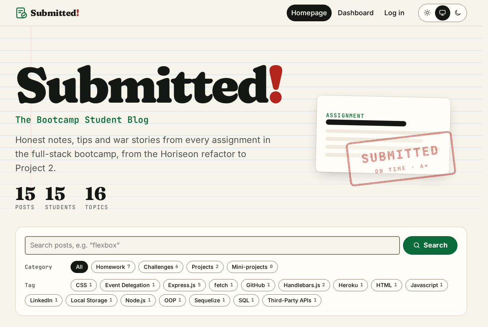
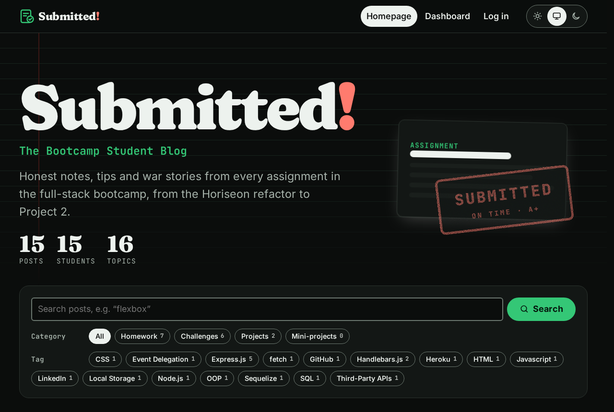
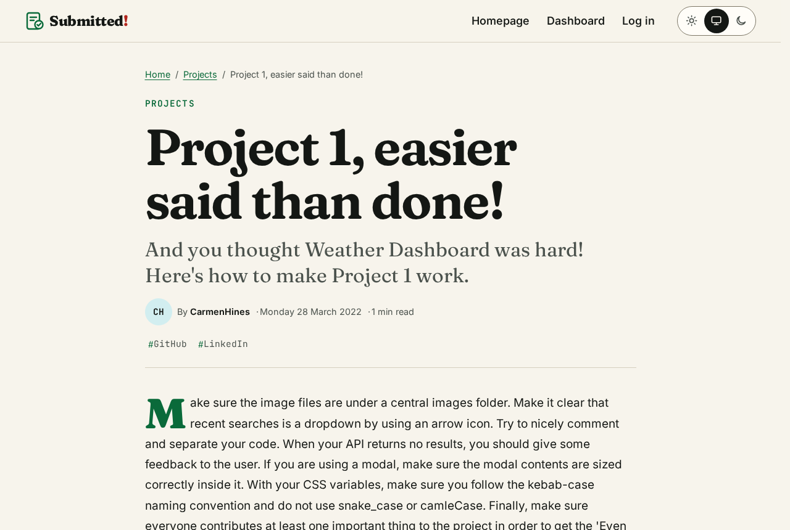
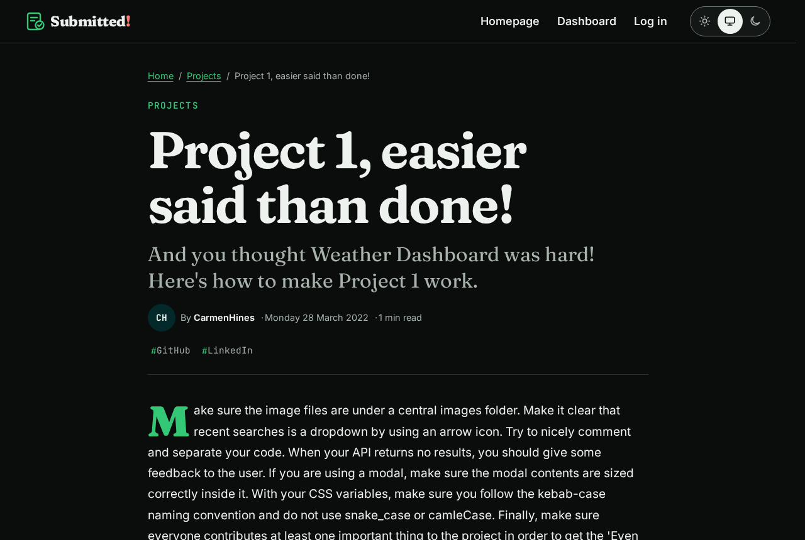
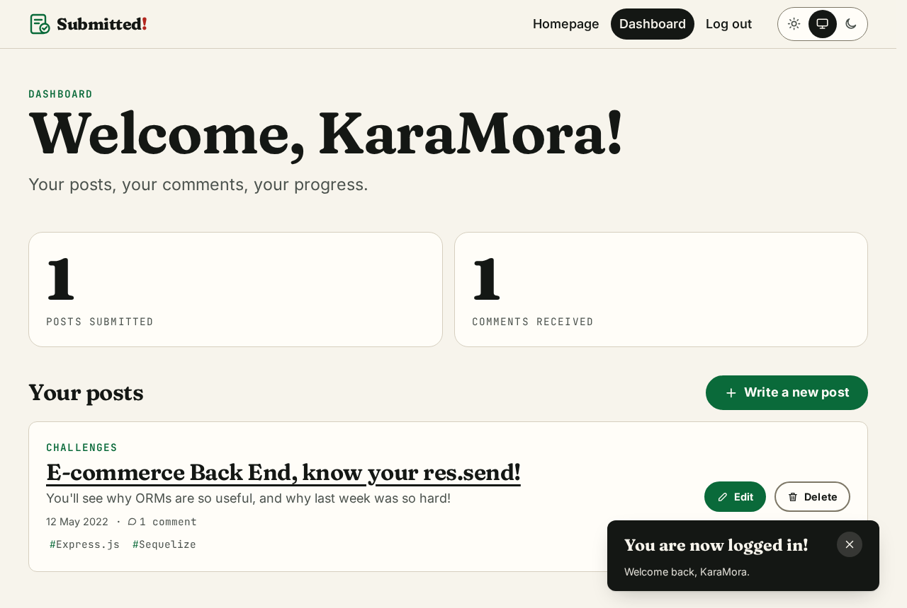
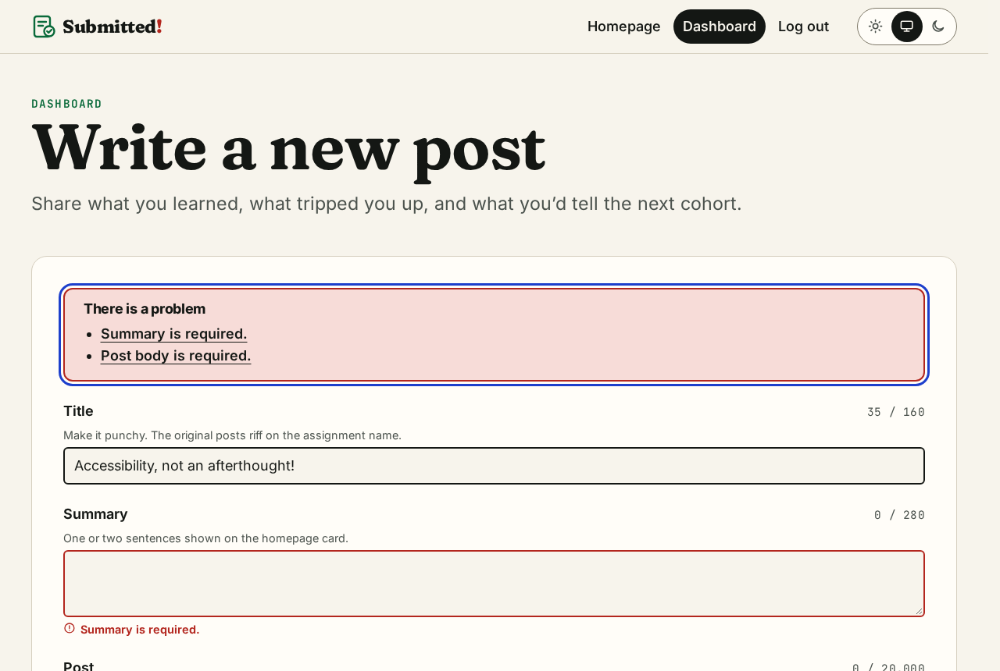
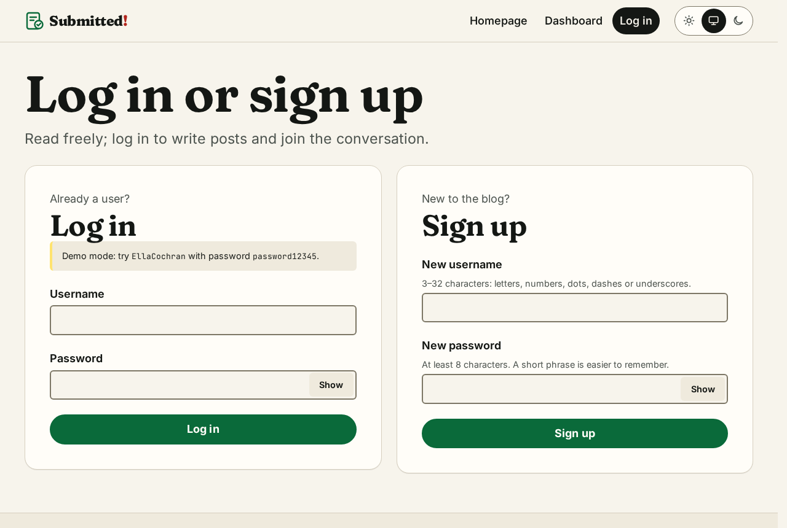
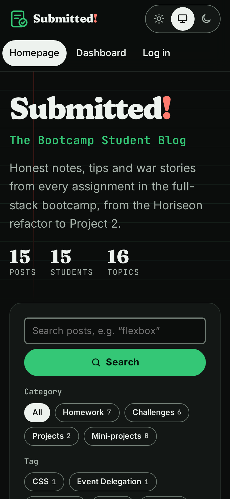

# Submitted!

**The Bootcamp Student Blog.** Read honest notes from every assignment in a full-stack coding bootcamp, then sign up to write your own posts and comment on others.

Originally built in 2022 as an Express + Handlebars + Sequelize MVC project. Rebuilt in 2026 as a server-rendered React app that is accessible by default, works without JavaScript, and runs with zero setup.

     

| Light                                               | Dark                                              |
| --------------------------------------------------- | ------------------------------------------------- |
|  |  |
|      |      |

<details>
<summary>More screenshots: dashboard, validation, login, mobile</summary>






</details>

## Quick start

```sh
git clone https://github.com/leoelicos/submitted.git
cd submitted
npm install
npm run dev
```

Open http://localhost:5173. That's it: no MySQL install and no `.env` needed. Without `DATABASE_URL` the app runs [PGlite](https://pglite.dev) (real Postgres compiled to WASM) in-process, then migrates and seeds the original 2022 posts on first boot.

Demo accounts: any seeded student, e.g. `EllaCochran` / `password12345`.

To keep data between restarts, copy `.env.example` to `.env` (it sets `PGLITE_DIR=.data/pglite`).

## Features

- **Read**: homepage of every post with search, category and tag filters (shareable URLs), reading time and comment counts. Posts are public.
- **Write**: dashboard with your stats, create, edit and delete posts with a category and up to 8 tags. Only the author can edit or delete.
- **Discuss**: comment on any post when logged in; delete your own comments.
- **Account**: sign up, log in, log out. Usernames are unique (case-insensitive), passwords are 8+ characters and hashed with scrypt.
- **Themes**: light, dark or system, remembered in a cookie so the server renders the right one with no flash.
- **Read-only JSON API**: `GET /api/blog`, `/api/blog/:id`, `/api/category`, `/api/tag`.

## Stack: before and after

|               | 2022                                   | 2026                                                                                                                                                             |
| ------------- | -------------------------------------- | ---------------------------------------------------------------------------------------------------------------------------------------------------------------- |
| Framework     | Express 4 + express-handlebars         | React Router 8 framework mode (SSR, loaders/actions, middleware), React 19.3                                                                                     |
| Language      | JavaScript                             | TypeScript 7 (native compiler), `strict` + `noUncheckedIndexedAccess` + `exactOptionalPropertyTypes`                                                             |
| Build         | none                                   | Vite 8 (Rolldown)                                                                                                                                                |
| Database      | MySQL via Sequelize 6 (JawsDB/Heroku)  | Postgres via Drizzle ORM; PGlite for dev/test/demo, `pg` for production                                                                                          |
| Sessions      | express-session in a MySQL table       | Signed, HttpOnly, SameSite cookie session; per-request user via middleware                                                                                       |
| Passwords     | bcrypt (native addon)                  | Node's built-in scrypt, timing-safe compare                                                                                                                      |
| Validation    | Sequelize `len` on password only       | Zod 4 schemas shared by every form, server-validated                                                                                                             |
| Client JS     | 4 hand-written DOM scripts + `alert()` | Progressive enhancement; every form works with JS off                                                                                                            |
| CSS           | normalize.css + one stylesheet         | Native CSS: cascade layers, `light-dark()` design tokens, `color-mix()`, container queries, `:has()`, `field-sizing`, scroll-driven animations, view transitions |
| Lint / format | ESLint 8 (airbnb) + Prettier 2         | oxlint (React, jsx-a11y, TypeScript, unicorn, import, vitest) + oxfmt                                                                                            |
| Tests         | none                                   | Vitest 5 unit tests + Playwright end-to-end with axe-core                                                                                                        |
| CI            | none                                   | GitHub Actions                                                                                                                                                   |

## Accessibility

Target: **WCAG 2.2 AA**, and AAA (7:1) for body and secondary text in both themes. See [`/accessibility`](app/routes/accessibility.tsx) for the public statement.

- Landmarks, a skip link, one `h1` per page, breadcrumbs with `aria-current`.
- After client-side navigation, focus moves to the new page heading and the page title is announced.
- Forms: visible labels, hints wired with `aria-describedby`, inline errors plus a focused error summary that links to each field, values preserved on error, polite character counters near the limit.
- Login supports password managers and paste (`autocomplete`), with a show/hide password toggle (WCAG 3.3.8).
- Delete confirmation uses the native `<dialog>` (focus trap, Esc, focus return).
- Notifications live in a persistent `role="status"` region, are dismissable, and pause on hover/focus.
- Visible focus rings, 24px+ targets, forced-colours support, no colour-only meaning.
- `prefers-reduced-motion` turns off every animation and view transition.
- Contrast is enforced in code: `tests/unit/contrast.test.ts` checks every token pair in light and dark.
- axe-core runs on every page (light + dark, signed-in, error states) in CI.

## Design

Ruled notebook paper by day, terminal black by night (a nod to the original black-and-`#2ab865` palette). Fraunces (soft variable serif) for display, Inter for UI, JetBrains Mono for metadata. A rubber "SUBMITTED" stamp is the motif: it slams onto the hero card and onto the screen when you publish a post. Post titles morph from card to article with shared-element view transitions; cards rise in with a scroll-driven animation. All of it is skipped under reduced motion.

## Scripts

| Script                | What it does                                                    |
| --------------------- | --------------------------------------------------------------- |
| `npm run dev`         | Dev server with HMR                                             |
| `npm run build`       | Production build to `build/`                                    |
| `npm start`           | Serve the production build (`PORT`, default 3000)               |
| `npm run typecheck`   | Generate route types, then `tsc`                                |
| `npm run lint`        | oxlint                                                          |
| `npm run format`      | oxfmt (write); `format:check` to verify                         |
| `npm test`            | Vitest unit tests (data layer runs against in-memory PGlite)    |
| `npm run test:e2e`    | Playwright + axe (builds and starts the app itself)             |
| `npm run check`       | typecheck + lint + format check + unit tests                    |
| `npm run db:generate` | Generate a SQL migration from `app/lib/schema.ts` (drizzle-kit) |
| `npm run db:migrate`  | Apply migrations to `DATABASE_URL` or `PGLITE_DIR`              |
| `npm run db:seed`     | Migrate, then seed the original content if the DB is empty      |

First-time Playwright setup: `npx playwright install chromium`.

## Environment

| Variable         | Required                  | Purpose                                                         |
| ---------------- | ------------------------- | --------------------------------------------------------------- |
| `DATABASE_URL`   | Production                | Postgres connection string (Neon, Vercel Postgres, Supabase...) |
| `SESSION_SECRET` | Production with a real DB | Signs the session cookie                                        |
| `PGLITE_DIR`     | No                        | Persist the PGlite demo DB to a folder instead of memory        |

## Deploy

Any Node 22.22+ host works: `npm run build && npm start`.

**With a real database** (recommended): provision Postgres (for example Neon via the Vercel Marketplace), set `DATABASE_URL` and `SESSION_SECRET`, then run `npm run db:seed` once (it migrates first).

**Demo mode**: with no `DATABASE_URL` the server boots an in-memory PGlite seeded with the original posts. Great for previews; data resets whenever the instance restarts.

**Vercel**: Vercel detects React Router and deploys it zero-config. Its optional `@vercel/react-router` preset does not support React Router 8 yet ([vercel/vercel#16730](https://github.com/vercel/vercel/issues/16730)), so it isn't installed; add it once that ships.

## Project layout

```
app/
  root.tsx            document shell, middleware (user + security headers), error boundary
  routes.ts           route config
  routes/             pages, actions and the JSON API
  components/         header, cards, forms, dialog, toasts, theme switch, route focus
  lib/                schema, queries, sessions, validation, migrations, seed data
  styles/             tokens, base, layout, components, motion (cascade layers)
drizzle/              generated SQL migrations
scripts/              migrate + seed CLIs
tests/unit/           Vitest
tests/e2e/            Playwright + axe
```

## Credits

- Original bootcamp project and seed content by Leo Wong, 2022, adapted from BCS resources.
- Fonts: Fraunces, Inter, JetBrains Mono via Fontsource (SIL OFL).

## License

&copy; Leo Wong <leoelicos@gmail.com>. Licensed under the [MIT License](./LICENSE).
